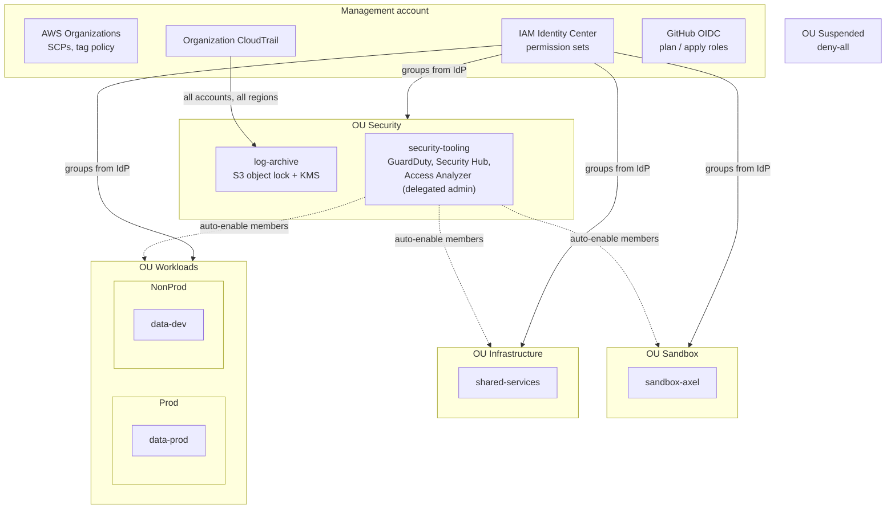

# AWS Platform Foundation

A **multi-account AWS landing zone written in plain Terraform**, without Control Tower or AFT. It covers the organization structure, guardrails, account vending, centralized security and human access.

Day-to-day changes are **YAML edits reviewed in a pull request**:
- adding an account;
- granting a team access;
- giving a repository a deployment role.

The pipeline plans every stack and every account, then applies them in dependency order after approval.

## Architecture



## Guardrails (SCPs)

| Policy | Attached to | Effect |
|---|---|---|
| `deny-leave-organization` | Root | Member accounts cannot leave the org |
| `deny-root-user` | Root | The root user of member accounts is unusable |
| `protect-security-baseline` | Root | CloudTrail, GuardDuty, Security Hub, Config, Access Analyzer and the org access role cannot be disabled or edited |
| `deny-iam-users` | Root | No IAM users or access keys: humans use SSO, workloads use roles |
| `region-lock` | Infrastructure, Workloads, Sandbox | Regional services only in `eu-west-3` and `eu-west-1`; global services are excluded |
| `workload-guardrails` | Workloads, Sandbox | IMDSv2 required, EBS encryption required, S3 account public access block locked |
| `deny-all` | Suspended | Quarantine for accounts being closed |

Only the pipeline roles and `OrganizationAccountAccessRole` (break-glass) are exempt. Every SCP is built with `jsonencode`, so tests can check its content and its **5,120-character limit**.

## Repository layout

```text
.
├── config/
│   ├── platform.yaml      # org name, regions, email pattern
│   ├── accounts.yaml      # account vending + per-account GitHub deployment roles
│   └── access.yaml        # permission sets + group assignments
├── policies/              # inline IAM policies referenced from access.yaml
├── modules/               # each module has its own terraform test suite
│   ├── scp/               # guardrail library + attachments
│   ├── account_vending/   # accounts in their OU, plus-addressed emails, budgets
│   ├── github_oidc_role/  # OIDC role pinned to repo + explicit subjects
│   └── permission_sets/   # Identity Center sets + assignments + privilege guard
├── stacks/                # applied in this order
│   ├── 00-bootstrap/          # state bucket, GitHub OIDC, plan/apply roles (manual, once)
│   ├── 10-organization/       # org, OUs, SCPs, tag policy, accounts, delegated admins
│   ├── 20-log-archive/        # WORM CloudTrail bucket + KMS key   (log-archive account)
│   ├── 30-security-services/  # org trail, GuardDuty, Security Hub, Access Analyzer, alerts
│   ├── 40-identity/           # Identity Center from access.yaml
│   └── 50-account-baseline/   # per-account defaults + GitHub roles (one state per account)
└── .github/workflows/
    ├── platform.yml       # static checks, tests, plans on PR, ordered applies on main
    └── _terraform.yml     # reusable plan/apply job
```

## Design decisions

- **Stacks instead of one big root module.** The blast radius stays small and plans stay fast. Each stack has its own state, and the stacks read each other through `terraform_remote_state`.
- **Configuration as data.** `accounts.yaml` and `access.yaml` are what people edit. The modules validate them: unique kebab-case names, known OUs and policies, session duration limits.
- **Static `for_each` keys.** SCP attachments are keyed by OU *name*, not OU ID. A `terraform test` caught this: keying by ID would have failed on the very first apply, when the IDs are still unknown.
- **No privileged access to prod.** A precondition in `permission_sets` refuses any assignment of a privileged permission set to a prod or security account, and privileged sessions last at most 1 h.
- **Least privilege in CI.** Pull requests only get `platform-terraform-plan`: read-only in management, plus a read-only role of the same name in each member account. The admin `platform-terraform-apply` role is only issued to jobs running in the protected `management` environment.
- **Tamper-proof logs.** The org trail writes to a bucket in a separate account. That bucket has object lock (GOVERNANCE, 1 year), a dedicated KMS key whose policy is restricted to that one trail, and TLS-only access. The SCP prevents stopping the trail.
- **Security from a delegated admin.** GuardDuty (with S3, EBS malware, RDS and Lambda protection), Security Hub (FSBP) and the organization-wide Access Analyzer are run from `security-tooling`, and new accounts are enrolled automatically. High-severity findings go to email through EventBridge → SNS (encrypted with a CMK, which EventBridge requires).

## Tests

21 `terraform test` cases run **without any AWS credentials**, against mocked providers:

```bash
for d in modules/* stacks/10-organization stacks/40-identity stacks/50-account-baseline; do
  terraform -chdir=$d init -backend=false >/dev/null && terraform -chdir=$d test
done
```

The stack tests plan the **real `config/*.yaml` files**. A typo in an OU path, a duplicate account, a wildcard OIDC subject or admin access on prod fails the PR before any AWS call.

## Deploy

1. **Bootstrap** (admin of the management account, once):
   ```bash
   terraform -chdir=stacks/00-bootstrap init && terraform -chdir=stacks/00-bootstrap apply
   ```
   If the organization already exists, import it before the first apply of `10-organization`:
   ```bash
   terraform -chdir=stacks/10-organization import aws_organizations_organization.this <o-id>
   ```
2. **GitHub setup**:
   - repository variables `AWS_REGION`, `TF_STATE_BUCKET`, `AWS_PLAN_ROLE_ARN`;
   - an environment `management` with required reviewers, a main-only branch rule and `AWS_APPLY_ROLE_ARN`.
3. **First apply** from `main` creates the organization, the accounts and the baselines. Member-account plans in PRs work from then on, because the baseline creates the read-only plan roles.
4. **Enable IAM Identity Center** in the management account (console, one click) and connect your IdP before applying `40-identity`.

## Cost

Organizations, SCPs, Identity Center and IAM are free. The running costs are:
- the org trail: the first copy of management events is free, and S3/KMS storage costs cents;
- GuardDuty and Security Hub, billed per account and per volume (a few dollars per account each month at low activity);
- 4 KMS keys at about $1 each.

Suspend or delete the security stack in a lab to stay near zero.

## Status and roadmap

Validated locally with `terraform validate` and `terraform test` on Terraform 1.16 and AWS provider 6.x. **Not yet applied to a real organization.** The bootstrap step expects an empty management account, or an imported organization.

Next steps:
- AWS Config conformance packs aggregated in `security-tooling`
- IPAM and a shared Transit Gateway in `shared-services`
- Automated account closure (move to Suspended → close after 90 days)
- Permissions boundaries on roles created by workload pipelines
- Drift detection: a scheduled plan that opens an issue when it finds changes
